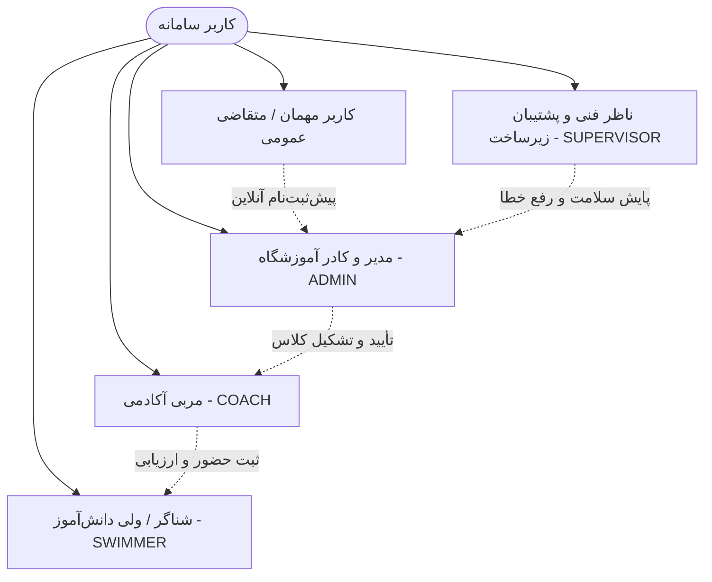
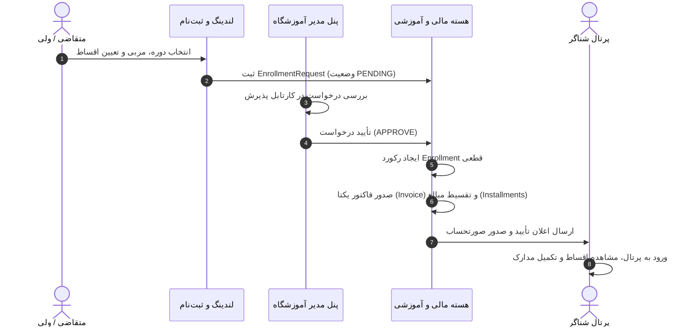
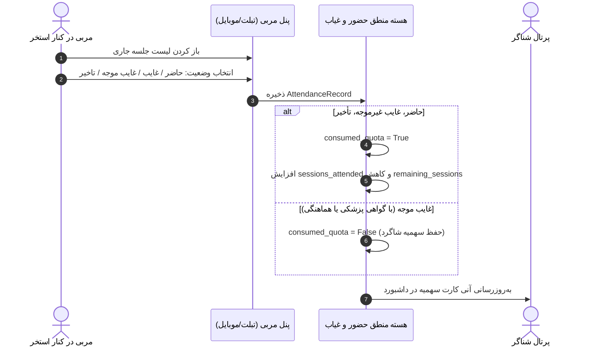

# 🏊‍♂️ سامانه جامع مدیریت آکادمی و آموزشگاه شنا (IranSwim)
## سند معرفی، اهداف، ساختار و راهنمای جامع پروژه (Project Overview)

---

## ۱. مقدمه و نگاه کلی (Executive Summary)

سامانه **ایران‌سوییم (IranSwim)** یک پلتفرم جامع، مدرن و یکپارچه تحت وب برای مدیریت هوشمند و مکانیزه آموزشگاه‌ها، آکادمی‌ها و مجموعه‌های ورزش‌های آبی است. این سامانه با هدف حذف فرآیندهای سنتی، دستی و کاغذی طراحی شده و تمامی ارکان یک آکادمی شنا — شامل **مدیران، مربیان، شناگران، اولیا، پرسنل پذیرش و ناظران فنی** — را در یک بستر هماهنگ، چابک و امن به هم متصل می‌سازد.

ایران‌سوییم نه تنها یک سامانه مدیریت آموزشی (LMS)، بلکه ترکیبی از **سیستم مدیریت مالی و اقساط (Financial Management)**، **سیستم رزرواسیون و برنامه‌ریزی استخر (Pool Scheduling)**، **دفتر الکترونیک حضور و غیاب با کسر هوشمند سهمیه (Attendance & Quota Control)**، **سنجش استاندارد مهارت‌ها و سطوح شنا (Skill Rubrics)**، **لیگ و مدیریت رکوردهای مسابقاتی (Time Trials & League Rankings)** و **پیشخوان پایش سلامت و باگ‌یابی سیستمی (Supervisor & System Health)** است.

---

## ۲. چالش‌های آکادمی‌های سنتی و راهکارهای ایران‌سوییم

| چالش در آکادمی‌های سنتی شنا | راهکار و نوآوری ایران‌سوییم (IranSwim) |
| :--- | :--- |
| **محاسبه پیچیده شهریه‌ها و پیگیری اقساط** | سیستم اتوماتیک صدور فاکتور با قابلیت پرداخت چندمرحله‌ای/اقساطی، تخصیص خودکار واریزی‌ها و یادآوری سررسیدها |
| **سوخت شدن یا ابهام در سهمیه جلسات غیبت** | کسر خودکار و دقیق سهمیه بر اساس حضور/غیاب؛ تمایز شفاف بین غیبت موجه (بدون کسر سهمیه) و غیرموجه |
| **تداخل ساعت کاری مربیان و خطوط استخر** | موتور هوشمند بررسی تداخل زمانی (Conflict Detection) در زمان تخصیص مربی و استخر در تقویم آموزشی |
| **عدم اطلاع والدین از پیشرفت فرزندان** | پرونده آنلاین مهارت‌آموزی، مشاهده وضعیت چک‌لیست آیتم‌های شنا (کرال سینه، پشت، قورباغه، پروانه) و نمرات مربی |
| **گم شدن مدارک فیزیکی و انقضای بیمه ورزشی** | بارگذاری آنلاین تصاویر شناسنامه، کارت ملی و کارت بیمه ورزشی با پایش تاریخ انقضا و تایید سیستمی |
| **عدم وجود سیستم رقابتی و انگیزش شناگران** | ماژول لیگ رقابتی با ثبت دقیق رکوردهای زمانی به تفکیک استخر ۲۵ یا ۵۰ متر و رده‌بندی پویای قهرمانان |
| **ایزوله بودن سایت اطلاع‌رسانی از پنل داخلی** | وب‌سایت لندینگ مدرن و یکپارچه با پنل ادمین جهت مدیریت بخش‌ها، اخبار، گالری استخرها و ثبت‌نام آنلاین |
| **بی‌اطلاعی مدیران از خرابی‌های سرور یا باگ‌ها** | پنل ناظر فنی (Supervisor) با ثبت بلادرنگ استک‌ترس خطاها بدون افشای اطلاعات محرمانه |

---

## ۳. گروه‌های کاربری و ذینفعان سامانه (User Personas & Roles)

سامانه بر پایه **مدل کنترل دسترسی مبتنی بر نقش (Role-Based Access Control)** پیاده‌سازی شده و دارای ۴ نقش اصلی به همراه کاربران مهمان است:

### ۱. مدیر آموزشگاه (Admin)
- **شرح نقش:** مدیر اصلی یا کارشناسان ثبت‌نام و پذیرش آکادمی.
- **اختیارات کلیدی:** تعریف و مدیریت دوره‌ها، ظرفیت‌بندی کلاس‌ها، تخصیص مربیان، مدیریت پرونده‌های شناگران، صدور فاکتور و ثبت اقساط، تایید رکوردهای مسابقاتی، مدیریت اخبار و محتوای لندینگ و تنظیمات سیستم.

### ۲. مربی آکادمی (Coach)
- **شرح نقش:** کادر مربیگری و مدرسان شنای باشگاه.
- **اختیارات کلیدی:** مشاهده کلاس‌های روزانه و هفتگی خود، دفتر الکترونیک حضور و غیاب، باز کردن پرونده فنی و آموزشی شناگر، ارزیابی سرفصل‌های مهارتی، ثبت رکوردهای زمانی (کرال، پروانه و...) و طراحی برنامه‌های تمرینی (Workout Plans).

### ۳. شناگر یا سرپرست قانونی (Swimmer / Guardian)
- **شرح نقش:** اعضای آکادمی اعم از کودکان (با نظارت والدین) یا بزرگسالان.
- **اختیارات کلیدی:** مشاهده برنامه جلسات و تقویم کلاس، مانده سهمیه جلسات، دفترچه حضور و غیاب شخصی، گزارش پیشرفت و رادار مهارت‌ها، رتبه‌بندی در لیگ، وضعیت فاکتورها و پرداخت اقساط، بارگذاری مدارک هویتی و ثبت تیکت پشتیبانی.

### ۴. ناظر فنی سامانه (Supervisor)
- **شرح نقش:** تیم توسعه،运维 و پایش عملکرد پلتفرم.
- **اختیارات کلیدی:** مانیتورینگ زنده وضعیت سرور و زمان پاسخ دیتابیس، رصد لحظه‌ای باگ‌ها با جزئیات کامل استک‌ترس (Stack Trace)، مشاهده لاگ حسابرسی فعالیت‌های حساس و تست و شبیه‌سازی سلامت سامانه.

### ۵. متقاضیان و عموم کاربران (Public Visitors)
- مشاهده خدمات آموزشگاه، بیوگرافی مربیان، تصاویر و آدرس استخرهای همکار، تقویم دوره‌های آماده ثبت‌نام و امکان ارسال درخواست پذیرش آنلاین.

---

## ۴. بررسی دقیق ماژول‌ها و پرتال‌های سامانه

### ۴.۱. پرتال عمومی و صفحه اصلی (Public Landing Page)
طراحی شده با تلفیقی از ظرافت بصری و عملکرد سریع:
- **جلوه‌های بصری پیشرفته:** شبیه‌سازی موج و انعکاس آب استخر با کتابخانه `Three.js` و انیمیشن‌های روان `GSAP`.
- **معرفی دوره‌های آموزشی:** فیلتر بر اساس رده سنی (کودکان، نوجوانان، بزرگسالان)، سطح مهارت و سانس‌های استخر.
- **نقشه و گالری استخرها:** نمایش استخرهای طرف قرارداد (مانند استخر شهید رئیسی و...) روی نقشه تعاملی همراه با لیست امکانات (سونا، جکوزی، عمق و ابعاد).
- **معرفی کادر مربیان:** نمایش رزومه، کارت‌های مربیگری، افتخارات و تخصص هر مربی.
- **فرم ثبت‌نام آنلاین (Online Enrollment):** ثبت تقاضای دوره، انتخاب مربی و انتخاب تعداد اقساط بدون نیاز به مراجعه حضوری.
- **ماژول اخبار و رویدادها:** دسترسی به جدیدترین اطلاعیه‌ها، مسابقات و مقالات آموزشی بهداشت استخر.

---

### ۴.۲. پنل پیشخوان مدیر آموزشگاه (Admin Operations Hub)
یک اتاق فرمان ۱۴ بخشی برای مدیریت صفر تا صد باشگاه:
1. **داشبورد تحلیلی:** نمایش شاخص‌های عملکرد (KPI) شامل تعداد شناگران فعال، درصد ظرفیت پر شده، درآمد محقق‌شده ماه، اقساط معوقه و جلسات امروز.
2. **مدیریت شناگران (Swimmers):** آرشیو پرونده‌ها، جستجو، فیلتر وضعیت مدارک هویتی و امکان ثبت‌نام مستقیم بدون فرآیند آنلاین.
3. **مدیریت مربیان (Coaches):** مشاهده ساعت کاری، محاسبه حق‌الزحمه بر اساس نرخ ساعتی، تخصیص گروه‌ها و مشاهده وضعیت اشتغال.
4. **تعریف دوره‌ها و گروه‌ها (Courses & Groups):** امکان تعیین تاریخ شروع و پایان، روزهای هفته، بازه ساعت، سقف اقساط و ساخت خودکار گروه‌ها برای مربیان.
5. **جلسات و تقویم هفتگی (Sessions):** مدیریت روزبه‌روز جلسات، تغییر ساعت، کنسلی کلاس با درج علت و تعریف جلسات جبرانی (Makeup Sessions).
6. **دفتر حضور و غیاب کل آکادمی (Attendance):** گزارش جامع حضور و غیاب، بررسی غیبت‌های متوالی و نظارت بر کسر سهمیه‌ها.
7. **امور مالی و فاکتورها (Finance Hub):** صدور فاکتور با شماره یکتا (`INV-YYYYMMDD-XXXXXX`)، مدیریت اقساط، ثبت پرداختی‌ها با انواع روش‌ها (کارتخوان، کارت‌به‌کارت، آنلاین) و اعمال تخفیف/استرداد.
8. **سنجش مهارت‌ها (Assessments):** تعریف درختواره سطوح (مبتدی، متوسط، پیشرفته، ستاره) و معیارهای قبولی برای هر سبک شنا.
9. **لیگ و مسابقات (Leagues):** تشکیل لیگ، تعیین رده‌های سنی، ثبت امتیازات تیمی/انفرادی و جدول قهرمانان.
10. **مدیریت وب‌سایت (Website Manager):** امکان روشن/خاموش کردن بخش‌های صفحه اصلی و چیدمان پویای محتوا بدون نیاز به کدنویسی.
11. **اخبار و اعلانات (News & Announcements):** انتشار اطلاعیه‌ها با جامعه هدف تفکیک‌شده (همه، فقط مربیان، فقط شناگران یک گروه خاص).
12. **گزارش‌گیری و خروجی اکسل/CSV:** استخراج آمار مالی، سوابق کلاسی و لیست شاگردان.
13. **امنیت و دسترسی کاربران (Security & Users):** مدیریت کلمات عبور، بازنشانی رمز و نظارت بر نشست‌های فعال.
14. **پروفایل آموزشگاه (Academy Profile):** تنظیم نام، آدرس، تلفن و لوگوی رسمی آکادمی.

---

### ۴.۳. پنل مربیان آکادمی (Coach Portal)
ابزار تخصصی و در دست مربی در لبه استخر:
- **لیست کلاس‌های روز و جاری:** دسترسی تک‌کلیکی به شاگردان کلاسی که هم‌اکنون در حال برگزاری است.
- **دفتر ثبت حضور و غیاب سریع:** رابط لمسی سریع برای علامت زدن حاضر، غایب، غایب موجه یا تأخیر با بازخورد آنی.
- **پرونده آموزشی و فنی شناگر (Swimmer Dossier):** مشاهده تاریخچه پزشکی، نکات خاص شناگر و سوابق نمرات جلسات قبل.
- **ارزیابی سرفصل‌ها و آزمون سطح (Exams & Assessments):** فرم ساده ثبت قبولی یا نیاز به تمرین با قابلیت ثبت یادداشت تکنیکی برای هر مهارت.
- **ثبت رکوردهای زمانی:** فرم کرونومتر و ورود زمان شناگر در مواد مختلف جهت ارسال برای تایید مدیر یا درج در کارنامه.
- **طراحی برنامه‌های تمرینی (Workout Builder):** بخش‌بندی تمرین شامل گرم‌کردن، ست‌های اصلی شنا و سردکردن با هدف‌گذاری مهارتی.
- **اعلانات و پیام‌ها:** مشاهده فوری اطلاعیه‌های ابلاغ‌شده از سوی مدیریت باشگاه.

---

### ۴.۴. پرتال شناگر و خانواده (Swimmer Portal)
فضایی شفاف، دوستانه و شفاف برای ورزشکاران و والدین:
- **میز کار شناگر (Dashboard):** کارت سهمیه جلسات باقیمانده، کارت قسط بعدی به همراه تاریخ سررسید و باکس جلسه بعدی.
- **برنامه هفتگی و تقویم جلسات:** تقویم آموزشی دوره‌های ثبت‌نام‌شده با مشخصات استخر و مربی.
- **دفترچه سوابق حضور:** ریز جزئیات هر جلسه با وضعیت حضور/غیاب، یادداشت مربی و ساعت دقیق.
- **کارنامه رشد و رادار مهارت‌ها:** نمایش گرافیکی مهارت‌های کسب‌شده در هر سطح و بازخوردهای مربیان.
- **باشگاه مسابقات و لیگ:** مشاهده جایگاه در جدول امتیازات لیگ آکادمی و رکوردهای ثبت‌شده شخصی در استخر ۲۵ و ۵۰ متر.
- **وضعیت مالی و فاکتورها:** مشاهده صورتحساب‌ها، جدول اقساط و مبالغ پرداخت‌شده و مانده بدهی.
- **تکمیل پرونده و بارگذاری مدارک:** امکان بارگذاری عکس کارت ملی، شناسنامه و کارت بیمه ورزشی معتبر با نمایش وضعیت تأیید یا دلیل نیاز به اصلاح.
- **میز تیکت و پشتیبانی:** ارسال پیام به مدیریت در خصوص هماهنگی مرخصی، جابه‌جایی کلاس، امور بیمه یا مسائل مالی.

---

### ۴.۵. مرکز پایش سلامت و ناظر فنی (Supervisor Hub)
ویژه‌ترین وجه تمایز ایران‌سوییم برای استقرار بدون دغدغه در سطح پروداکشن:
- **پایش زنده سلامت (Health Check):** تست ارتباط با دیتابیس PostgreSQL و محاسبه تأخیر پاسخ (Latency) بر حسب میلی‌ثانیه.
- **ردگیر استک‌ترس خطاها (System Error Log):** به دام انداختن خودکار تمامی کرش‌ها و خطاهای HTTP 500 در میدل‌ویر اختصاصی با جزئیات کامل خطوط کد، کاربر، IP و پارامترهای درخواست.
- **امنیت داده‌ها (Sanitization):** محو خودکار اطلاعات حساس نظیر رمزهای عبور و توکن‌ها قبل از ثبت در لاگ.
- **ردپای حسابرسی (Audit Trail):** ثبت کلیه اقدامات حیاتی سیستم نظیر تغییر نقش‌ها، ثبت مبالغ مالی، استردادها و ویرایش حضور و غیاب.
- **محیط تست خطا (Bug Trigger Test):** قابلیت شبیه‌سازی خطای کنترل‌شده جهت اطمینان از سلامت پایپ‌لاین لاگینگ و آلارم‌ها.

---

## ۵. سناریوهای اصلی چرخه حیات سامانه (Core Workflows)

### ۵.۱. چرخه ثبت‌نام، تأیید و تقسیط شهریه

---

### ۵.۲. چرخه حضور و غیاب و کسر هوشمند سهمیه جلسات

---

## ۶. اصول طراحی و تجربه کاربری (UI / UX Architecture)

1. **فلسفه طراحی متناسب با موضوع شنا (Aquatic Theme):**
   - الهام‌گرفته از رنگ‌های فیروزه‌ای عمیق، آبی اقیانوسی و شفافیت آب استخر.
   - بهره‌گیری از پالت‌های رنگی ملایم برای جلوگیری از خستگی چشم مربیان و مدیران حین کار ممتد.
2. **راست‌چین اصیل و فونت استاندارد:**
   - استفاده از قلم استاندارد و پرطرفدار **وزیرمتن (Vazirmatn)** به صورت لود محلی (بدون وابستگی به اینترنت جهانی).
   - رعایت دقیق فواصل، ترازها، نشانگرهای وضعیت و تقویم شمسی جلالی در تمامی جداول و فرم‌ها.
3. **ریسپانسیو و لمس‌پذیر (Mobile & Tablet Friendly):**
   - پنل مربیان به گونه‌ای طراحی شده که با تبلت‌های ضدآب یا گوشی‌های هوشمند در لبه استخر به سادگی و با دکمه‌های بزرگ قابل لمس باشد.
4. **سرعت و بارگذاری سبک:**
   - عدم وجود بسته‌های حجیم بلااستفاده و بهینه‌سازی تصاویر با ابزارهای نوین جهت کارکرد روان با اینترنت‌های کم‌سرعت.

---

## ۷. نقشه راه و پتانسیل‌های آینده (Roadmap)

- [ ] اتصال به درگاه‌های پرداخت اینترنتی آنلاین مستقیم شتابی (زرین‌پال، سداد، به‌پرداخت).
- [ ] اتصال به پنل‌های پیامکی خدماتی (کاوه نگار، فراپیامک) جهت ارسال پیامک خودکار سررسید قسط و یادآوری جلسات.
- [ ] اضافه کردن ماژول بوفه و فروشگاه لوازم شنا (مایو، عینک، کلاه، فین و دوقلو).
- [ ] اپلیکیشن PWA موبایل با قابلیت کارکرد آفلاین موقت برای لبه استخر در صورت قطعی شبکه.
