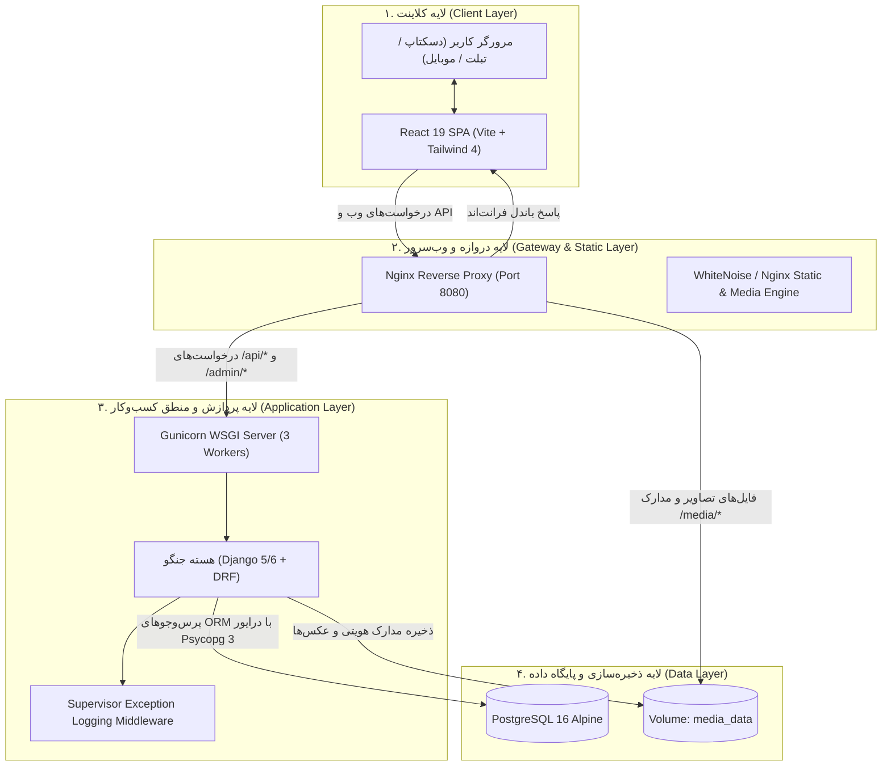
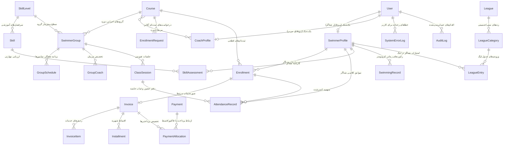
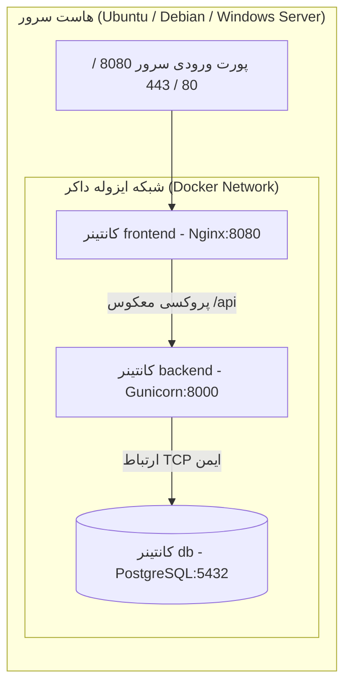

# 🛠️ مستندات فنی و مهندسی معماری سامانه ایران‌سوییم (IranSwim)
## Comprehensive Technical Documentation & Architecture Specification

---

## ۱. معماری کلان نرم‌افزار (System Architecture Overview)

سامانه **ایران‌سوییم (IranSwim)** بر پایه معماری مدرن **سرویس‌گیرنده/سرویس‌دهنده تفکیک‌شده (Decoupled Client-Server / Single Page Application)** بنا شده است. این ساختار تضمین‌کننده مقیاس‌پذیری بالا، پایداری عملیاتی، قابلیت نگهداری آسان و تجربه کاربری نرم و سریع است.

### توپولوژی سرویس‌ها و جریان داده (High-Level Topology)



---

## ۲. پشته فناوری (Technology Stack)

### ۲.۱. بخش بک‌اند (Backend)
- **زبان برنامه‌نویسی:** Python 3.11 / 3.12
- **فریم‌ورک اصلی:** Django 5.x / 6.x
- **فریم‌ورک API:** Django REST Framework (DRF) 3.14+
- **احراز هویت:** `djangorestframework-simplejwt` مبتنی بر استانداردهای امنیتی RFC 7519
- **درایور دیتابیس:** `psycopg[binary] 3.1.18+` (نسل جدید با عملکرد بالا و بهینه‌سازی اتصال به PostgreSQL)
- **مستندسازی API:** `drf-spectacular` جهت تولید اتوماتیک اسناد تعاملی OpenAPI 3.0 و Swagger UI
- **اپلیکیشن سرور:** `gunicorn 21.2+`
- **مدیریت فایل‌های استاتیک:** `whitenoise 6.6+`
- **پردازش تصاویر:** `Pillow 10.0+`
- **چارچوب تست خودکار:** `pytest` و `pytest-django`

### ۲.۲. بخش فرانت‌اند (Frontend)
- **کتابخانه اصلی:** React 19.3
- **محیط بیلد و باندلر:** Vite 8.3
- **مسیریابی (Routing):** React Router DOM v7
- **سیستم طراحی و استایلینگ:** Tailwind CSS v4 با کامپایلر بومی `@tailwindcss/vite`
- **رندرهای سه‌بعدی و بصری آب:** Three.js 0.186
- **موتور انیمیشن:** GSAP 3.15
- **نقشه تعاملی:** Leaflet 1.9
- **تقویم و تاریخ جلالی (شمسی):** Jalaali-js 2.0
- **آیکون‌ها:** Lucide React
- **کلاینت HTTP:** Axios با Interceptorهای خودکار برای الحاق توکن JWT Bearer
- **لینتر:** Oxlint (سریع‌ترین ابزار لینت مبتنی بر Rust)

### ۲.۳. لایه زیرساخت و دواپس (DevOps & Infrastructure)
- **کانتینرسازی:** Docker با استراتژی چندمرحله‌ای (Multi-Stage Build)
- **ارکستراسیون محلی و سرور:** Docker Compose v2
- **وب سرور:** Nginx Alpine
- **پایگاه داده رابطه‌ای:** PostgreSQL 16 Alpine با والوم دائمی `postgres_data`

---

## ۳. ساختار فیزیکی پروژه و ماژول‌ها (Project Directory Structure)

```
iranswim/
├── .env.example                # الگو متغیرهای محیطی سیستم
├── docker-compose.yml          # تعریف سرویس‌های داکر (db, backend, frontend)
├── pytest.ini                  # پیکربندی اجرای آزمون‌های pytest
├── README.md                   # راهنمای سریع راه‌اندازی
├── PROJECT_OVERVIEW.md         # سند تفصیلی معرفی پروژه و ابعاد کسب‌وکار
├── TECHNICAL_DOCUMENTATION.md  # سند معماری و مستندات فنی حاضر
│
├── backend/
│   ├── Dockerfile              # داکرفایل بک‌اند پایتون/جنگو
│   ├── requirements.txt        # لیست وابستگی‌های پایتون
│   ├── manage.py               # مدریتور فرامین جنگو
│   ├── config/                 # پیکربندی کلی پروژه جنگو
│   │   ├── settings.py         # تنظیمات محیطی، دیتابیس، میدل‌ویرها و احراز هویت
│   │   ├── urls.py             # مسیریابی اصلی روت‌های API و Admin
│   │   └── wsgi.py             # نقطه ورود WSGI برای سرور Gunicorn
│   │
│   ├── apps/                   # ۱۱ ماژول ایزوله و مستقل کسب‌وکار
│   │   ├── accounts/           # مدل کاربر سفارشی با موبایل، OTP، JWT و نقش‌ها
│   │   ├── swimmers/           # پرونده شناگران، بارگذاری مدارک هویتی و بیمه
│   │   ├── coaches/            # پرونده مربیان، تخصص‌ها، نرخ ساعتی و پلن‌های تمرین
│   │   ├── education/          # سطوح مهارتی، دوره‌ها، کلاس‌ها، ثبت‌نام و ظرفیت
│   │   ├── scheduling/         # جلسات کلاسی، تقویم و موتور کشف تداخل زمانی
│   │   ├── attendance/         # دفتر حضور و غیاب، کسر سهمیه و گزارشات
│   │   ├── finance/            # فاکتورها، اقساط، پرداخت‌ها با کلید Idempotency
│   │   ├── assessments/        # ارزیابی مهارتی، نمرات و رکوردهای زمانی شنا
│   │   ├── leagues/            # مسابقات لیگ، رده‌بندی سنی و جدول امتیازات
│   │   ├── content/            # اخبار، استخرها، گالری، تیکت پشتیبانی و لندینگ
│   │   └── supervisor/         # میدل‌ویر لاگ خطا، استک‌ترس، مانیتورینگ سلامت
│   │
│   └── tests/                  # سوئیت تست‌های خودکار یکپارچگی و واحد
│
└── frontend/
    ├── package.json            # وابستگی‌ها و اسکریپت‌های کلاینت
    ├── vite.config.js          # پیکربندی باندلر ویت و پلاگین‌های CSS
    ├── nginx.conf              # پیکربندی وب‌سرور Nginx برای پروداکشن
    ├── Dockerfile              # داکرفایل چندمرحله‌ای بیلد React و استقرار روی Nginx
    └── src/
        ├── api/                # کلاینت متمرکز Axios با هدرهای Authorization
        ├── assets/             # تصاویر، گرافیک‌های SVG و نشان‌ها
        ├── components/
        │   ├── common/         # کامپوننت‌های عمومی (دکمه، مدال، لودینگ، کارت)
        │   ├── landing/        # سکشن‌های صفحه اصلی لندینگ
        │   └── layout/         # نوبار، سایدبار و شل مشترک داشبوردها
        ├── context/            # کانتکست‌های ری‌اکت (Auth, Toast, Theme, Swimmer)
        ├── pages/
        │   ├── public/         # صفحات عمومی: لندینگ و لاگین/ثبت‌نام
        │   ├── admin/          # ۱۴ صفحه اختصاصی پنل مدیریت آموزشگاه
        │   ├── coach/          # ۱۱ صفحه اختصاصی پرتال مربیان
        │   ├── swimmer/        # ۱۲ صفحه اختصاصی پرتال شناگر و خانواده
        │   └── supervisor/     # صفحات مانیتورینگ خطا و سلامت سیستم
        └── utils/              # هلپرهای تاریخ شمسی (Jalaali) و خروجی CSV
```

---

## ۴. طراحی پایگاه داده و دیاگرام ارتباطات (Database Schema & ERD)

پایگاه داده به صورت کاملاً نرمال‌سازی‌شده (Normalized) با رعایت قیود یکپارچگی ارجاعی (Referential Integrity)، کلیدهای خارجی و تراکنش‌های اتمیک طراحی شده است.



### ویژگی‌های پیشرفته در لایه مدل‌ها (Advanced Model Mechanics):
1. **استفاده از `DecimalField` برای مبالغ مالی:**
   جهت پیشگیری از خطای محاسبات ممیز شناور (Floating Point Inaccuracies)، کلیه فیلدهای پولی (شهریه، اقساط، پرداختی‌ها، تخفیف‌ها) به صورت `DecimalField(max_digits=12, decimal_places=2)` تعریف شده‌اند.
2. **شمارشگر فاکتور یکتا با پیشوند استاندارد:**
   متد کلاسی `generate_invoice_number` در مدل `Invoice` با فرمت `INV-YYYYMMDD-XXXXXX` شماره فاکتورهای غیرتکراری و خوانا برای امور مالیاتی و حسابداری ایجاد می‌کند.
3. **قیود یکتایی مرکب (Unique Constraints):**
   - جلوگیری از ثبت‌نام تکراری شناگر در یک دوره یکسان: `UniqueConstraint(fields=['swimmer', 'course'])`
   - جلوگیری از ثبت دوگانه حضور و غیاب برای یک شناگر در یک جلسه: `UniqueConstraint(fields=['session', 'swimmer'])`
   - عضویت انحصاری در هر لیگ: `UniqueConstraint(fields=['league', 'swimmer'])`

---

## ۵. موتورهای منطقی و قوانین کلیدی کسب‌وکار (Core Business Engines)

### ۵.۱. موتور کنترل سهمیه و حضور و غیاب (Attendance & Quota Engine)
برخلاف سیستم‌های عمومی، ایران‌سوییم رفتار دقیقی در خصوص سهمیه جلسات دارد:
- **منطق کسر سهمیه:**
  - وضعیت **حاضر (PRESENT)** $\rightarrow$ کسر از سهمیه (`consumed_quota = True`)
  - وضعیت **غایب غیرموجه (ABSENT)** $\rightarrow$ کسر از سهمیه (`consumed_quota = True`)
  - وضعیت **حاضر با تأخیر (LATE)** $\rightarrow$ کسر از سهمیه (`consumed_quota = True`)
  - وضعیت **غایب موجه (EXCUSED)** $\rightarrow$ **بدون کسر از سهمیه** (`consumed_quota = False`)
- **به‌روزرسانی اتمیک:** هنگام ثبت یا ویرایش رکورد حضور و غیاب در متد `save()`، فیلد `sessions_attended` در مدل `Enrollment` مرتبط به طور خودکار برابر با تعداد کل رکوردهای `consumed_quota=True` آن شناگر در آن دوره قرار می‌گیرد و فیلد محاسباتی `remaining_sessions` بلافاصله تصحیح می‌شود.

---

### ۵.۲. موتور مالی و تخصیص اقساط (Financial & Payment Engine)
- **کلید یکتایی تراکنش (Idempotency Key):** فیلد `idempotency_key` بر روی مدل `Payment` مانع از ثبت تراکنش تکراری ناشی از دابل‌کلیک یا خطای شبکه در زمان ثبت پرداخت می‌گردد.
- **تخصیص هوشمند وجه پرداختی (Payment Allocation):** هنگام ثبت یک واریزی، سیستم مبلغ را به اقساط پرداخت‌نشده دوره به ترتیب نزدیک‌ترین تاریخ سررسید تخصیص داده و وضعیت قسط را از `UNPAID` به `PARTIAL` یا `PAID` تغییر می‌دهد.
- **محاسبه تراز جاری فاکتور:**
  $$\text{مانده بدهی} = (\text{مبلغ کل فاکتور} - \text{تخفیف‌ها}) - \text{مجموع پرداخت‌های موفق} + \text{استردادها}$$
  هرگاه مانده بدهی صفر یا منفی شود، وضعیت فاکتور به شکل خودکار `PAID` اعلام می‌شود.

---

### ۵.۳. موتور کشف تداخل زمانی استخر و مربی (Conflict Detection Engine)
در مدل `ClassSession` در متد اعتبارسنجی `clean()` پیش از ذخیره جلسه در دیتابیس، دو بررسی بحرانی اجرا می‌شود:
1. **تداخل کاری مربی:** مربی انتخابی نباید در بازه زمانی تعیین‌شده در جلسه کلاسی دیگری (در همان روز) حضور داشته باشد.
2. **تداخل فیزیکی استخر:** اگر یک استخر دارای محدودیت خط یا فضا باشد، سامانه از تعریف همپوشان چند جلسه با ظرفیت متناقض در یک مکان جلوگیری کرده و خطای صریح صادر می‌کند.

---

### ۵.۴. میدل‌ویر ناظر فنی و ردگیری استک‌ترس (Supervisor Exception Middleware)
میدل‌ویر اختصاصی `SupervisorExceptionLoggingMiddleware` به عنوان آخرین لایه در پایپ‌لاین جنگو قرار گرفته است:
1. **به دام انداختن بدون کرش:** تمامی استثناهای پیش‌بینی‌نشده (Uncaught Exceptions / 500) قبل از ارسال به کلاینت متوقف می‌شوند.
2. **پالایش امن داده‌ها (Sanitization):** متد `sanitize_data` کلیدهای حساسی چون `password`، `token`، `access`، `refresh`، `secret` و `authorization` را به `***REDACTED***` تبدیل می‌کند تا حریم خصوصی کاربران در دیتابیس لاگ خدشه‌دار نشود.
3. **ثبت استک‌ترس و بازگشت شناسه پیگیری:** رکورد کاملی در جدول `SystemErrorLog` ذخیره می‌شود و کلاینت پاسخی با فرمت زیر دریافت می‌کند:
   ```json
   {
     "detail": "خطای غیرمنتظره‌ای در سرور رخ داده است. این رخداد با موفقیت در سامانه ناظر ثبت گردید.",
     "error_tracking_id": 42,
     "exception_type": "ValueError"
   }
   ```
   شناگر یا ادمین می‌تواند این کد پیگیری را به پشتیبانی اعلام کند و ناظر فنی در پنل با یک کلیک استک‌ترس کامل، آدرس IP و خطای دقیق را مشاهده می‌نماید.

---

## ۶. معماری امنیت و کنترل دسترسی (Security & Auth Architecture)

### ۶.۱. احراز هویت با JWT (JSON Web Tokens)
- ورود اولیه با شماره تلفن همراه و کلمه عبور انجام می‌شود.
- پس از تأیید، دو توکن استاندارد تولید می‌گردد:
  - **Access Token:** با طول عمر کوتاه (۱۵ دقیقه) برای همراهی در هدر `Authorization: Bearer <token>` در کلیه درخواست‌ها.
  - **Refresh Token:** با طول عمر بلندتر (۷ روز) جهت تمدید بدون وقفه نشست کاری کاربر.
- توکن‌ها حاوی کلیم‌های هویتی (`user_id`, `role`, `phone`, `first_name`, `last_name`) هستند که به کلاینت اجازه رندر شرطی المان‌های واسط کاربری را می‌دهد.

### ۶.۲. لایه‌های مجوزدهی نقش‌محور (Role Permissions)
دسترسی‌ها در سطح ویوهای DRF با کلاس‌های مجوز سفارشی در `apps.accounts.permissions` اعتبارسنجی می‌شوند:
- `IsAdminUserRole`: ویژه مدیران آکادمی یا سوپریوزرها.
- `IsCoachUserRole`: ویژه مربیان برای مشاهده گروه‌ها و ثبت رکوردهای کلاس خود.
- `IsSwimmerUserRole`: ویژه شناگران برای مشاهده فاکتورها، برنامه و پرونده شخصی.
- `IsSupervisorUserRole`: ویژه ناظرین فنی برای مشاهده گزارش‌های سلامت و باگ‌ها.

### ۶.۳. سیاست‌های حفاظتی Nginx و Django
- **محافظت در برابر حملات تزریق (SQL Injection):** استفاده ۱۰۰٪ از ORM امن جنگو و اجتناب از Raw Queries بدون پارامتر.
- **محافظت در برابر XSS:** فرار دادن خودکار کاراکترها در React و تنظیم هدرهای `X-XSS-Protection` و `X-Content-Type-Options: nosniff`.
- **سیاست‌های اشتراک منابع مبدأ (CORS):** محدودسازی مجاز بودن فراخوانی فرانت‌اند از طریق تنظیمات متغیر محیطی `CORS_ALLOWED_ORIGINS`.

---

## ۷. مشخصات API و اندپوینت‌های کلیدی (RESTful API Specifications)

مستندات تعاملی استاندارد Swagger و اسکیما OpenAPI به صورت زنده روی سرور در دسترس هستند:
- **رابط بصری Swagger UI:** `http://SERVER_HOST:8000/api/docs/`
- **اسکیمای کامل JSON/YAML:** `http://SERVER_HOST:8000/api/schema/`

### ماتریس طبقه‌بندی روت‌های اصلی API:

| ماژول و پیشوند مسیر | مسئولیت و اندپوینت‌های کلیدی | متدهای مجاز |
| :--- | :--- | :--- |
| `/api/auth/` | ثبت‌نام، ورود، رفرش توکن، بازنشانی رمز و دریافت اطلاعات کاربری من (`/me/`) | `POST`, `GET`, `PATCH` |
| `/api/education/` | مدیریت دوره‌ها (`courses`)، گروه‌ها، سطوح مهارتی و پذیرش درخواست‌های ثبت‌نام | `GET`, `POST`, `PUT`, `DELETE` |
| `/api/scheduling/` | تقویم جلسات کلاسی، ثبت جلسه جدید، کنسلی و تعریف جلسه جبرانی | `GET`, `POST`, `PATCH` |
| `/api/attendance/` | لیست سوابق حضور، ثبت وضعیت کلاسی شاگردان با اعمال اثر سهمیه | `GET`, `POST`, `PUT` |
| `/api/finance/` | صدور صورتحساب، لیست اقساط، ثبت پرداخت و اعمال تخفیف/استرداد | `GET`, `POST`, `PATCH` |
| `/api/swimmers/` | پروفایل شناگران، بارگذاری مدارک هویتی، آدرس و وضعیت تایید اسناد | `GET`, `POST`, `PATCH` |
| `/api/coaches/` | پروفایل مربیان، پلن‌های تمرینی و ساعات کاری | `GET`, `POST`, `PUT` |
| `/api/assessments/`| نمرات سرفصل‌های مهارت و ثبت رکوردهای زمانی کرونومتر | `GET`, `POST`, `PATCH` |
| `/api/leagues/` | لیگ‌های فعال، رده‌های مسابقاتی و رتبه‌بندی ورزشکاران | `GET`, `POST` |
| `/api/content/` | اخبار، استخرهای همکار، اعلانات، نوتیفیکیشن‌ها و تیکت‌های پشتیبانی | `GET`, `POST`, `PATCH` |
| `/api/supervisor/` | چک زنده سلامت سرور، لاگ استک‌ترس خطاها، رفع خطا و لاگ حسابرسی | `GET`, `POST`, `PATCH` |

---

## ۸. راهنمای محیط توسعه محلی (Local Development Setup)

### پیش‌نیازها:
- پایتون نسخه 3.11 یا بالاتر
- نود نسخه 20 یا بالاتر همراه با npm
- Git

### ۸.۱. راه‌اندازی بخش بک‌اند (Backend)
```powershell
# ۱. رفتن به ریشه پروژه و ایجاد محیط مجازی پایتون
py -m venv venv
.\venv\Scripts\activate

# ۲. ارتقای pip و نصب نیازمندی‌های بک‌اند
pip install -r backend/requirements.txt

# ۳. اجرای مایگریشن‌ها بر روی دیتابیس (به طور پیش‌فرض SQLite توسعه)
python backend/manage.py migrate

# ۴. تولید داده‌های اولیه و کاربران تستی (Seed Data)
python backend/manage.py seed_data

# ۵. اجرای وب‌سرور توسعه جنگو
python backend/manage.py runserver 0.0.0.0:8000
```

### ۸.۲. راه‌اندازی بخش فرانت‌اند (Frontend)
```powershell
# در یک ترمینال جداگانه:
cd frontend
npm install
npm run dev
```
- فرانت‌اند به طور پیش‌فرض روی آدرس `http://localhost:5173/` اجرا شده و درخواست‌های خود را به بک‌اند روی پورت ۸۰۰۰ ارسال می‌کند.

---

## ۹. استقرار پروداکشن با Docker Compose (Production Deployment)

معماری استقرار پروداکشن به صورت ۳ کانتینر ایزوله داخل یک شبکه اختصاصی (Bridge Network) پیکربندی شده است:



### مراحل راه‌اندازی با یک دستور:

#### ۱. ساخت فایل تنظیمات محیطی:
یک کپی از `.env.example` با نام `.env` ایجاد کرده و کلید محرمانه اختصاصی خود را وارد نمایید:
```bash
cp .env.example .env
```

نمونه مقادیر متغیرها:
```env
POSTGRES_DB=iranswim
POSTGRES_USER=postgres
POSTGRES_PASSWORD=StrongProductionPassword2026!
DJANGO_SECRET_KEY=super-secret-production-random-key
DJANGO_DEBUG=False
ALLOWED_HOSTS=yourdomain.ir,127.0.0.1,localhost
CSRF_TRUSTED_ORIGINS=https://yourdomain.ir,http://localhost:8080
CORS_ALLOWED_ORIGINS=https://yourdomain.ir,http://localhost:8080
PORT=8080
```

#### ۲. بیلد و اجرای کانتینرها:
```bash
docker compose up -d --build
```

#### ۳. پر کردن داده‌های اولیه یا کاربر ریشه:
```bash
# ایجاد داده‌های اولیه نمونه برای آموزشگاه
docker compose exec backend python manage.py seed_data

# یا ساخت کاربر ادمین اصلی
docker compose exec backend python manage.py createsuperuser
```

#### ۴. مانیتورینگ وضعیت سرویس‌ها:
```bash
docker compose ps
docker compose logs -f backend
```

---

## ۱۰. آزمون‌های خودکار و تضمین کیفیت نرم‌افزار (Automated Testing)

سوئیت تست‌های نرم‌افزار با فریم‌ورک استاندارد Pytest پیاده‌سازی شده و تمامی بخش‌های حساس را پوشش می‌دهد:

```powershell
.\venv\Scripts\pytest.exe
```

### اهم موارد تحت پوشش آزمون‌ها:
1. **احراز هویت و مجوزها:** تست صدور صحیح Access/Refresh توکن، محدودیت‌های دسترسی کاربران با نقش‌های متفاوت به اندپوینت‌های اختصاصی.
2. **پایش سلامت و لاگ خطای ناظر:** شبیه‌سازی خطای 500 در یک View آزمایشی، اعتبارسنجی ثبت شدن استک‌ترس در جدول `SystemErrorLog`، پالایش فیلدهای رمز عبور و دریافت `error_tracking_id`.
3. **محاسبات مالی:** آزمون دقت اعشاری (Decimal) در تقسیم اقساط و عدم بروز خطای ممیز شناور در مبالغ بزرگ، جلوگیری از ثبت پرداخت با Idempotency Key تکراری.
4. **منطق کسر سهمیه در حضور و غیاب:** تست تغییر وضعیت به غایب موجه و تضمین عدم کسر سهمیه، در مقایسه با وضعیت‌های حاضر، غایب و تأخیر.
